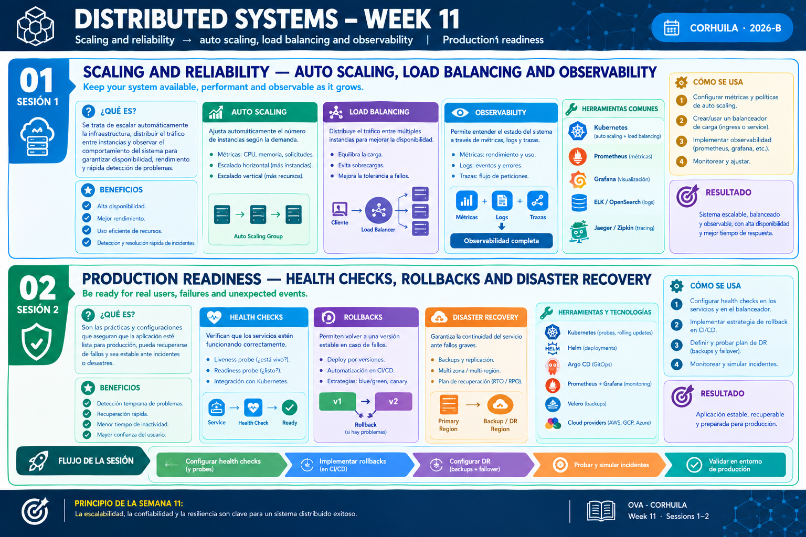

<!-- HU-STATUS TEMPLATE - do NOT remove the <!-- ... --> markers or the table headers.
     Your weekly grade is read AUTOMATICALLY from this file:
       11-week/hu-status/README.md  (inside YOUR fork). English. -->

# Weekly Status - Week 11

<!-- CONFIG-START - must match your profile repo (username/username) CONFIG -->
- FULL_NAME: Oscar Guillermo Sierra Lozano
- GITHUB_USER: Oscarsl10
- TEAM: CineSync Platform
- SPRINT_GOAL: Close the Auth stories HU-AUTH-001 and HU-AUTH-002 (register, login, refresh, purge), deliver HU-AUTH-003 (user roles, logout and web session) across the API, database, portal, shell and gateway, start HU-AUTH-004 (email change), plan the observability of the Auth service (SLOs, alert and runbook), and get ready for the demo of release v2.0.0 (front shell and portals) on Wednesday 2026-10-21.
<!-- CONFIG-END -->

## 1. User stories worked this week
| HU ID | Title | Status (todo/doing/done) | Evidence (PR or commit URL) |
|---|---|---|---|
| HU-AUTH-001 | Client Registers an Account | done | [csp-docs#144](https://github.com/code-corhuila/csp-docs/pull/144) (marked Done), [csp-auth-api#83](https://github.com/code-corhuila/csp-auth-api/pull/83) (release 3.0.0, open) |
| HU-AUTH-002 | User Authenticates and Receives Tokens | done | [csp-auth-api#55](https://github.com/code-corhuila/csp-auth-api/pull/55), [csp-auth-api#57](https://github.com/code-corhuila/csp-auth-api/pull/57), [csp-auth-api#59](https://github.com/code-corhuila/csp-auth-api/pull/59), [csp-worker#22](https://github.com/code-corhuila/csp-worker/pull/22), [csp-auth-db#27](https://github.com/code-corhuila/csp-auth-db/pull/27) |
| HU-AUTH-003 | Admin Manages User Roles | doing | [csp-auth-api#77](https://github.com/code-corhuila/csp-auth-api/pull/77), [csp-auth-api#79](https://github.com/code-corhuila/csp-auth-api/pull/79), [csp-auth-api#90](https://github.com/code-corhuila/csp-auth-api/pull/90), [csp-auth-portal#45](https://github.com/code-corhuila/csp-auth-portal/pull/45), [csp-auth-portal#46](https://github.com/code-corhuila/csp-auth-portal/pull/46), [csp-front#46](https://github.com/code-corhuila/csp-front/pull/46), [csp-api-gateway#4](https://github.com/code-corhuila/csp-api-gateway/pull/4) |
| HU-AUTH-004 | User Changes and Verifies Email | doing | [csp-auth-api#105](https://github.com/code-corhuila/csp-auth-api/pull/105), [csp-auth-api#107](https://github.com/code-corhuila/csp-auth-api/pull/107), [csp-auth-api#110](https://github.com/code-corhuila/csp-auth-api/pull/110), [csp-auth-portal#57](https://github.com/code-corhuila/csp-auth-portal/pull/57) (open), [csp-docs#147](https://github.com/code-corhuila/csp-docs/pull/147) (merged) |

## 2. My individual contribution

Only my own work is listed; in the repositories shared with the team (`csp-front`, `csp-api-gateway`, `csp-worker`, `csp-infra-*`) only the commits I authored are counted.

- **HU-AUTH-002, closing the story**: detection of the reuse of a refresh token that revokes the sessions of the user ([csp-auth-api#55](https://github.com/code-corhuila/csp-auth-api/pull/55)), internal operations protected by a service credential ([csp-auth-api#54](https://github.com/code-corhuila/csp-auth-api/pull/54)), purge of expired rows with its use case, PostgreSQL adapters and `POST /internal/maintenance/purge` ([csp-auth-api#56](https://github.com/code-corhuila/csp-auth-api/pull/56), [csp-auth-api#57](https://github.com/code-corhuila/csp-auth-api/pull/57)), the `purge-auth` job in `csp-worker` ([csp-worker#22](https://github.com/code-corhuila/csp-worker/pull/22)), and the purge grants and indexes in `csp-auth-db` ([csp-auth-db#27](https://github.com/code-corhuila/csp-auth-db/pull/27), [csp-auth-db#28](https://github.com/code-corhuila/csp-auth-db/pull/28)). Responses are validated against `auth-service.yaml` in contract tests ([csp-auth-api#53](https://github.com/code-corhuila/csp-auth-api/pull/53), [csp-auth-api#58](https://github.com/code-corhuila/csp-auth-api/pull/58)).
- **HU-AUTH-003, across the whole stack**: grant and revoke the `ADMIN` role, token verification and permission guards, `PATCH /users/{userId}/role` and `GET /users` ([csp-auth-api#77](https://github.com/code-corhuila/csp-auth-api/pull/77) to [csp-auth-api#80](https://github.com/code-corhuila/csp-auth-api/pull/80)), the revoked-access-token list in Redis and `POST /logout` ([csp-auth-api#89](https://github.com/code-corhuila/csp-auth-api/pull/89) to [csp-auth-api#91](https://github.com/code-corhuila/csp-auth-api/pull/91)); the Auth portal now calls the real API for sign in, register and recovery, with the admin page to search users and grant or revoke `ADMIN` and the session restored with the refresh token ([csp-auth-portal#44](https://github.com/code-corhuila/csp-auth-portal/pull/44) to [csp-auth-portal#51](https://github.com/code-corhuila/csp-auth-portal/pull/51)); the shell sends the access token, mounts the roles administration, shows Spanish copy and signs out on the server ([csp-front#45](https://github.com/code-corhuila/csp-front/pull/45) to [csp-front#55](https://github.com/code-corhuila/csp-front/pull/55)); the gateway routes `/api/v1/auth` ([csp-api-gateway#4](https://github.com/code-corhuila/csp-api-gateway/pull/4)). The stories and decisions were specified first in `csp-docs` (ADR-029 to ADR-034, contract and runbook updates).
- **HU-AUTH-004, started**: ADR-034 for the email change, contract 1.6.0 and data model ([csp-docs#147](https://github.com/code-corhuila/csp-docs/pull/147)), the use cases, adapters, endpoints and SMTP delivery of the code in open PRs ([csp-auth-api#105](https://github.com/code-corhuila/csp-auth-api/pull/105), [csp-auth-api#106](https://github.com/code-corhuila/csp-auth-api/pull/106), [csp-auth-api#107](https://github.com/code-corhuila/csp-auth-api/pull/107), [csp-auth-api#110](https://github.com/code-corhuila/csp-auth-api/pull/110)), the database change ([csp-auth-db#36](https://github.com/code-corhuila/csp-auth-db/pull/36)) and the profile page ([csp-auth-portal#57](https://github.com/code-corhuila/csp-auth-portal/pull/57)).
- **Platform**: the single Redis instance for the Auth state (`csp-infra-redis`, [csp-infra-redis#7](https://github.com/code-corhuila/csp-infra-redis/pull/7), ADR-028), and the platform composition including Redis, the API gateway and the purge settings ([csp-infra-postgres#11](https://github.com/code-corhuila/csp-infra-postgres/pull/11) to [csp-infra-postgres#13](https://github.com/code-corhuila/csp-infra-postgres/pull/13)). Healthchecks of the shell and portal containers fixed to `127.0.0.1`.
- **Releases 3.0.0 prepared** (open pull requests to `main`, waiting for the leader's OK): [csp-auth-api#83](https://github.com/code-corhuila/csp-auth-api/pull/83), [csp-auth-db#33](https://github.com/code-corhuila/csp-auth-db/pull/33), [csp-auth-portal#49](https://github.com/code-corhuila/csp-auth-portal/pull/49), [csp-api-gateway#6](https://github.com/code-corhuila/csp-api-gateway/pull/6), [csp-infra-redis#9](https://github.com/code-corhuila/csp-infra-redis/pull/9), [csp-infra-postgres#15](https://github.com/code-corhuila/csp-infra-postgres/pull/15), [csp-worker#24](https://github.com/code-corhuila/csp-worker/pull/24).
- **Session activities**: [session 1](../01-session/README.md) (observability assessment of the Auth service and the gaps to instrument) and [session 2](../02-session/README.md) (three SLOs, error-budget policy, one alert, one runbook and three testable observability stories).
- Full commit log of the week: [commits.md](commits.md).

## 3. Blockers and risks

- GitHub Actions cannot run since 2026-10-14 (billing lock): the pull requests of this period were validated locally and merged with the explicit authorization of the owner; the bot review was still required. CI evidence is missing for them.
- The 3.0.0 release pull requests are open and `main` needs the leader's OK; HU-AUTH-001 and HU-AUTH-002 are Done on the board but their code reaches `main` only with those releases.
- The Auth service logs errors with the trace id but exports no metrics or spans yet, so the SLOs of session 2 cannot be measured until the instrumentation of session 1 is built (it needs its own story and review).
- HU-AUTH-004 depends on an SMTP server for the real delivery of the code; the open pull requests wait for review.
- The 400-line PR cap keeps splitting each story into many small pull requests, which multiplies merges, promotions to `qa` and branch syncs.

## 4. Plan for next week

- Present the demo of release v2.0.0 on Wednesday 2026-10-21: the front shell and the domain portals ([csp-front](https://github.com/code-corhuila/csp-front/releases/tag/v2.0.0), [csp-auth-portal](https://github.com/code-corhuila/csp-auth-portal/releases/tag/v2.0.0), [csp-concessions-portal](https://github.com/code-corhuila/csp-concessions-portal/releases/tag/v2.0.0)).
- Finish HU-AUTH-004 (review of the open pull requests, promotion to `qa`) and start HU-AUTH-005 and HU-AUTH-006, spec and contract first, then a failing test, then the code.
- Decide with the team whether the observability stories of session 2 are filed; the instrumentation (request logs with the trace id, golden-signal metrics, one trace) is not implemented and stays a plan until then.
- Promote the 3.0.0 releases to `main` when ordered and keep the documentation in sync with every decision through `docs/* -> main` pull requests.

## 5. Compliance self-check

- [x] Conventional Commits - `type(scope): summary`
- [x] Per-environment HU branch + PR to that environment (code repos: child branch -> `develop`; `csp-docs`: `docs/* -> main`)
- [x] Testable acceptance criteria
- [x] Tests added/updated (unit / integration). Unit tests for the domain and use cases, integration tests for the adapters (PostgreSQL, Redis) and contract tests of the HTTP responses against `auth-service.yaml`; specs in the portal and the shell.
- [x] DDD / hexagonal boundaries respected (domain has no I/O)
- [x] No secrets; config via environment variables

## 6. Evidence links

- [Week 11 Full Commit Log](commits.md)
- [Session 1: observability](../01-session/README.md)
- [Session 2: SLOs, error budget, alert and runbook](../02-session/README.md)
- [Release v2.0.0: csp-front](https://github.com/code-corhuila/csp-front/releases/tag/v2.0.0)
- [Release v2.0.0: csp-auth-portal](https://github.com/code-corhuila/csp-auth-portal/releases/tag/v2.0.0)
- [Release v2.0.0: csp-concessions-portal](https://github.com/code-corhuila/csp-concessions-portal/releases/tag/v2.0.0)
- [Repository: csp-docs](https://github.com/code-corhuila/csp-docs)
- [Repository: csp-auth-api](https://github.com/code-corhuila/csp-auth-api)
- [Repository: csp-auth-db](https://github.com/code-corhuila/csp-auth-db)
- [Repository: csp-auth-portal](https://github.com/code-corhuila/csp-auth-portal)
- [Repository: csp-front](https://github.com/code-corhuila/csp-front)
- [Repository: csp-api-gateway](https://github.com/code-corhuila/csp-api-gateway)
- [Repository: csp-worker](https://github.com/code-corhuila/csp-worker)
- [Repository: csp-infra-redis](https://github.com/code-corhuila/csp-infra-redis)
- [Repository: csp-infra-postgres](https://github.com/code-corhuila/csp-infra-postgres)
- Week 11 summary session 1-2:

  
