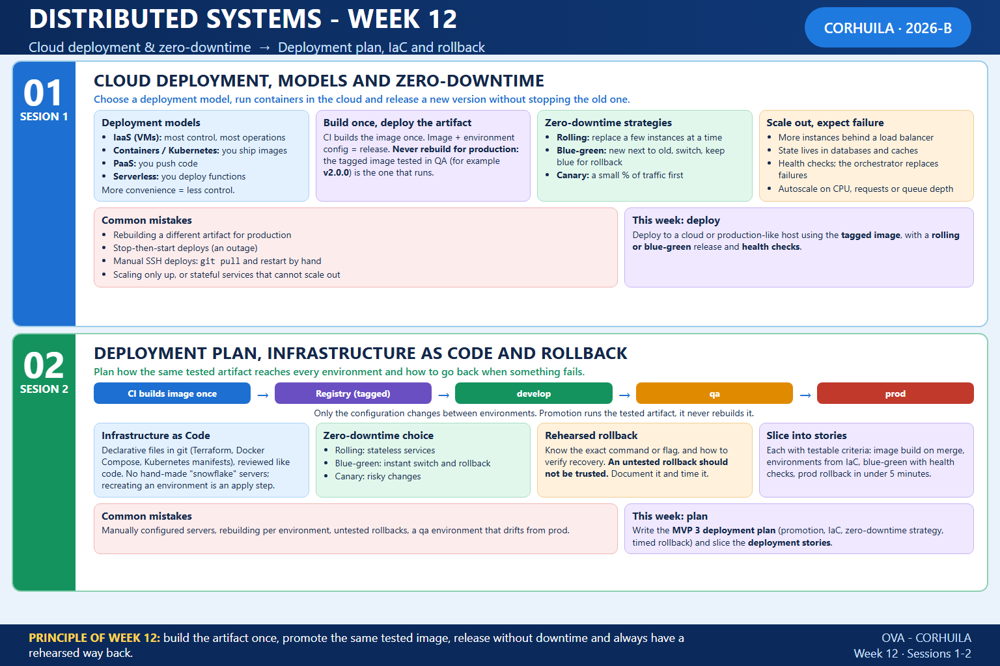

<!-- HU-STATUS TEMPLATE - do NOT remove the <!-- ... --> markers or the table headers.
     Your weekly grade is read AUTOMATICALLY from this file:
       12-week/hu-status/README.md  (inside YOUR fork). English. -->

# Weekly Status - Week 12

<!-- CONFIG-START - must match your profile repo (username/username) CONFIG -->
- FULL_NAME: Oscar Guillermo Sierra Lozano
- GITHUB_USER: Oscarsl10
- TEAM: CineSync Platform
- SPRINT_GOAL: Finish HU-AUTH-004 (change and verify the email) and HU-AUTH-005 (protection after repeated failed logins), deliver HU-AUTH-007 (own profile and password change), bring HU-AUTH-006 (password reset) to review, harden the platform around Auth (gateway, tokens, RabbitMQ relay), and keep the 3.0.0 releases ready for approval.
<!-- CONFIG-END -->

## 1. User stories worked this week
| HU ID | Title | Status (todo/doing/done) | Evidence (PR or commit URL) |
|---|---|---|---|
| HU-AUTH-003 | Admin Manages User Roles | done | [csp-auth-api#157](https://github.com/code-corhuila/csp-auth-api/pull/157), [csp-auth-portal#86](https://github.com/code-corhuila/csp-auth-portal/pull/86), [csp-docs#263](https://github.com/code-corhuila/csp-docs/pull/263) (revoking ADMIN ends the sessions of that user) |
| HU-AUTH-004 | User Changes and Verifies Email | done | [csp-auth-api#135](https://github.com/code-corhuila/csp-auth-api/pull/135), [csp-auth-api#136](https://github.com/code-corhuila/csp-auth-api/pull/136), [csp-auth-api#137](https://github.com/code-corhuila/csp-auth-api/pull/137), [csp-auth-portal#66](https://github.com/code-corhuila/csp-auth-portal/pull/66), [csp-auth-portal#69](https://github.com/code-corhuila/csp-auth-portal/pull/69), [csp-worker#42](https://github.com/code-corhuila/csp-worker/pull/42), [csp-docs#249](https://github.com/code-corhuila/csp-docs/pull/249), [csp-docs#251](https://github.com/code-corhuila/csp-docs/pull/251) |
| HU-AUTH-005 | Account Protection After Repeated Failed Logins | done | [csp-auth-api#129](https://github.com/code-corhuila/csp-auth-api/pull/129), [csp-auth-api#130](https://github.com/code-corhuila/csp-auth-api/pull/130), [csp-auth-api#131](https://github.com/code-corhuila/csp-auth-api/pull/131), [csp-auth-api#140](https://github.com/code-corhuila/csp-auth-api/pull/140), [csp-auth-portal#64](https://github.com/code-corhuila/csp-auth-portal/pull/64), [csp-auth-portal#72](https://github.com/code-corhuila/csp-auth-portal/pull/72), [csp-front#66](https://github.com/code-corhuila/csp-front/pull/66), [csp-docs#178](https://github.com/code-corhuila/csp-docs/pull/178), [csp-docs#252](https://github.com/code-corhuila/csp-docs/pull/252) |
| HU-AUTH-006 | Client Requests Password Reset | doing | [csp-auth-api#145](https://github.com/code-corhuila/csp-auth-api/pull/145), [csp-auth-api#146](https://github.com/code-corhuila/csp-auth-api/pull/146), [csp-auth-api#147](https://github.com/code-corhuila/csp-auth-api/pull/147), [csp-auth-api#148](https://github.com/code-corhuila/csp-auth-api/pull/148), [csp-auth-api#153](https://github.com/code-corhuila/csp-auth-api/pull/153), [csp-auth-db#42](https://github.com/code-corhuila/csp-auth-db/pull/42), [csp-auth-portal#76](https://github.com/code-corhuila/csp-auth-portal/pull/76), [csp-auth-portal#78](https://github.com/code-corhuila/csp-auth-portal/pull/78), [csp-docs#257](https://github.com/code-corhuila/csp-docs/pull/257), [csp-docs#258](https://github.com/code-corhuila/csp-docs/pull/258) (in review on the board) |
| HU-AUTH-007 | User Edits Own Profile and Changes Password | done | [csp-auth-api#158](https://github.com/code-corhuila/csp-auth-api/pull/158), [csp-auth-api#159](https://github.com/code-corhuila/csp-auth-api/pull/159), [csp-auth-api#160](https://github.com/code-corhuila/csp-auth-api/pull/160), [csp-auth-api#162](https://github.com/code-corhuila/csp-auth-api/pull/162), [csp-auth-portal#80](https://github.com/code-corhuila/csp-auth-portal/pull/80), [csp-auth-portal#81](https://github.com/code-corhuila/csp-auth-portal/pull/81), [csp-auth-portal#82](https://github.com/code-corhuila/csp-auth-portal/pull/82), [csp-api-gateway#22](https://github.com/code-corhuila/csp-api-gateway/pull/22), [csp-docs#262](https://github.com/code-corhuila/csp-docs/pull/262) |

## 2. My individual contribution

Only my own work is listed; in the repositories shared with the team (`csp-front`, `csp-api-gateway`, `csp-worker`, `csp-infra-*`) only the commits I authored are counted. The status of each story is the one of the board.

- **HU-AUTH-005, login protection**: domain and use case of the failed-login limit ([csp-auth-api#129](https://github.com/code-corhuila/csp-auth-api/pull/129)), the Redis adapter of the attempt counter and lock ([csp-auth-api#130](https://github.com/code-corhuila/csp-auth-api/pull/130)), `429 rate_limited` on `POST /login` with the client address ([csp-auth-api#131](https://github.com/code-corhuila/csp-auth-api/pull/131)), a bound on the latency of the limit when Redis does not answer ([csp-auth-api#140](https://github.com/code-corhuila/csp-auth-api/pull/140)), and the wait time shown on the login form ([csp-auth-portal#64](https://github.com/code-corhuila/csp-auth-portal/pull/64), [csp-auth-portal#72](https://github.com/code-corhuila/csp-auth-portal/pull/72), [csp-front#66](https://github.com/code-corhuila/csp-front/pull/66)). Decisions in ADR-040 and ADR-048 ([csp-docs#178](https://github.com/code-corhuila/csp-docs/pull/178), [csp-docs#252](https://github.com/code-corhuila/csp-docs/pull/252)).
- **HU-AUTH-004, email change**: use cases, adapters, `PATCH /me/email`, `POST /me/email/verify` and the SMTP delivery of the code ([csp-auth-api#105](https://github.com/code-corhuila/csp-auth-api/pull/105) to [csp-auth-api#112](https://github.com/code-corhuila/csp-auth-api/pull/112)), the profile page at `/profile` ([csp-auth-portal#57](https://github.com/code-corhuila/csp-auth-portal/pull/57), [csp-front#60](https://github.com/code-corhuila/csp-front/pull/60)), and the fixes of the integration campaign: email longer than 255 characters, `401` when the account is gone, a bulkhead that bounds the concurrent requests, `Idempotency-Key` on the calls, and the contract tests of the portal ([csp-auth-api#135](https://github.com/code-corhuila/csp-auth-api/pull/135), [csp-auth-api#136](https://github.com/code-corhuila/csp-auth-api/pull/136), [csp-auth-api#137](https://github.com/code-corhuila/csp-auth-api/pull/137), [csp-auth-api#141](https://github.com/code-corhuila/csp-auth-api/pull/141), [csp-auth-portal#66](https://github.com/code-corhuila/csp-auth-portal/pull/66), [csp-auth-portal#69](https://github.com/code-corhuila/csp-auth-portal/pull/69), [csp-docs#249](https://github.com/code-corhuila/csp-docs/pull/249), [csp-docs#251](https://github.com/code-corhuila/csp-docs/pull/251)). Purge of verification requests expired more than 7 days ago ([csp-auth-api#117](https://github.com/code-corhuila/csp-auth-api/pull/117), [csp-auth-db#37](https://github.com/code-corhuila/csp-auth-db/pull/37)).
- **HU-AUTH-006, password reset (in review)**: use cases, repository and purge, sender and settings, the `forgot-password` and `reset-password` routes, and the rule that the current password is rejected ([csp-auth-api#145](https://github.com/code-corhuila/csp-auth-api/pull/145), [csp-auth-api#146](https://github.com/code-corhuila/csp-auth-api/pull/146), [csp-auth-api#147](https://github.com/code-corhuila/csp-auth-api/pull/147), [csp-auth-api#148](https://github.com/code-corhuila/csp-auth-api/pull/148), [csp-auth-api#153](https://github.com/code-corhuila/csp-auth-api/pull/153)), the schema ([csp-auth-db#42](https://github.com/code-corhuila/csp-auth-db/pull/42)), the reset page of the portal ([csp-auth-portal#76](https://github.com/code-corhuila/csp-auth-portal/pull/76), [csp-auth-portal#78](https://github.com/code-corhuila/csp-auth-portal/pull/78)), specified in [csp-docs#257](https://github.com/code-corhuila/csp-docs/pull/257), [csp-docs#258](https://github.com/code-corhuila/csp-docs/pull/258).
- **HU-AUTH-007, own profile and password change**: specification ([csp-docs#262](https://github.com/code-corhuila/csp-docs/pull/262)), the use cases, `GET` and `PATCH /me`, the password change with its limiter and hash lock, and `POST /me/password` ([csp-auth-api#158](https://github.com/code-corhuila/csp-auth-api/pull/158), [csp-auth-api#159](https://github.com/code-corhuila/csp-auth-api/pull/159), [csp-auth-api#160](https://github.com/code-corhuila/csp-auth-api/pull/160), [csp-auth-api#161](https://github.com/code-corhuila/csp-auth-api/pull/161), [csp-auth-api#162](https://github.com/code-corhuila/csp-auth-api/pull/162)), the personal data and password sections of "Mi perfil" ([csp-auth-portal#80](https://github.com/code-corhuila/csp-auth-portal/pull/80), [csp-auth-portal#81](https://github.com/code-corhuila/csp-auth-portal/pull/81), [csp-auth-portal#82](https://github.com/code-corhuila/csp-auth-portal/pull/82)) and the gateway routes for `GET` and `PATCH /api/v1/auth/me` ([csp-api-gateway#22](https://github.com/code-corhuila/csp-api-gateway/pull/22)).
- **Sessions and tokens**: revoking ADMIN ends the sessions of that user ([csp-auth-api#157](https://github.com/code-corhuila/csp-auth-api/pull/157)), the logout and the removal of admin survive a disconnected client ([csp-auth-api#169](https://github.com/code-corhuila/csp-auth-api/pull/169), [csp-auth-api#171](https://github.com/code-corhuila/csp-auth-api/pull/171)), the access token lasts 15 minutes ([csp-auth-api#179](https://github.com/code-corhuila/csp-auth-api/pull/179), [csp-docs#268](https://github.com/code-corhuila/csp-docs/pull/268)), `GET /jwks` has a caching rule ([csp-auth-api#177](https://github.com/code-corhuila/csp-auth-api/pull/177)), ADMIN holds `concessions:inventory:read` ([csp-auth-api#180](https://github.com/code-corhuila/csp-auth-api/pull/180), [csp-docs#269](https://github.com/code-corhuila/csp-docs/pull/269)), and an offline command issues the service tokens ([csp-auth-api#181](https://github.com/code-corhuila/csp-auth-api/pull/181), [csp-docs#270](https://github.com/code-corhuila/csp-docs/pull/270)).
- **Gateway and shell hardening**: the gateway strips client-supplied `x-user` headers, exposes `Retry-After` to browsers and answers one correlation id, and accepts only safe ones ([csp-api-gateway#17](https://github.com/code-corhuila/csp-api-gateway/pull/17), [csp-api-gateway#18](https://github.com/code-corhuila/csp-api-gateway/pull/18), [csp-api-gateway#19](https://github.com/code-corhuila/csp-api-gateway/pull/19)); the shell sends its requests with `fetch`, removes the "my account" menu and keeps signed-in people off the login page ([csp-front#70](https://github.com/code-corhuila/csp-front/pull/70), [csp-front#73](https://github.com/code-corhuila/csp-front/pull/73)); the shell and the portal refuse an unanchored CORS regex ([csp-front#58](https://github.com/code-corhuila/csp-front/pull/58), [csp-auth-portal#59](https://github.com/code-corhuila/csp-auth-portal/pull/59), [csp-docs#156](https://github.com/code-corhuila/csp-docs/pull/156)).
- **RabbitMQ and the Auth relay**: ADR-036 and the repository `csp-infra-rabbitmq` with tests against a real broker ([csp-docs#160](https://github.com/code-corhuila/csp-docs/pull/160), [csp-docs#164](https://github.com/code-corhuila/csp-docs/pull/164), [csp-docs#179](https://github.com/code-corhuila/csp-docs/pull/179), [csp-infra-rabbitmq#2](https://github.com/code-corhuila/csp-infra-rabbitmq/pull/2), [csp-infra-rabbitmq#3](https://github.com/code-corhuila/csp-infra-rabbitmq/pull/3), [csp-infra-rabbitmq#5](https://github.com/code-corhuila/csp-infra-rabbitmq/pull/5)), and the relay of the Auth outbox in `csp-worker` behind its own flag, with an instance lock, the compose variables and the fix found by the integration campaign ([csp-worker#27](https://github.com/code-corhuila/csp-worker/pull/27), [csp-worker#29](https://github.com/code-corhuila/csp-worker/pull/29), [csp-worker#31](https://github.com/code-corhuila/csp-worker/pull/31), [csp-worker#33](https://github.com/code-corhuila/csp-worker/pull/33), [csp-worker#42](https://github.com/code-corhuila/csp-worker/pull/42)).
- **Platform**: logins `auth_migrator` and `booking_migrator` ([csp-infra-postgres#17](https://github.com/code-corhuila/csp-infra-postgres/pull/17), [csp-infra-postgres#19](https://github.com/code-corhuila/csp-infra-postgres/pull/19), [csp-infra-postgres#21](https://github.com/code-corhuila/csp-infra-postgres/pull/21)), the SMTP relay of Auth passed from the environment files and the Auth purge enabled in `qa` ([csp-infra-postgres#22](https://github.com/code-corhuila/csp-infra-postgres/pull/22), [csp-infra-postgres#27](https://github.com/code-corhuila/csp-infra-postgres/pull/27)), and the runbook of Auth updated for the SMTP provider and the service token of the worker ([csp-docs#169](https://github.com/code-corhuila/csp-docs/pull/169), [csp-docs#256](https://github.com/code-corhuila/csp-docs/pull/256)).
- **Releases 3.0.0 prepared**: eight pull requests to `main`, open and waiting for the approval, now carrying the stories HU-AUTH-001 to HU-AUTH-007: [csp-auth-api#83](https://github.com/code-corhuila/csp-auth-api/pull/83), [csp-auth-db#33](https://github.com/code-corhuila/csp-auth-db/pull/33), [csp-auth-portal#49](https://github.com/code-corhuila/csp-auth-portal/pull/49), [csp-front#61](https://github.com/code-corhuila/csp-front/pull/61), [csp-api-gateway#6](https://github.com/code-corhuila/csp-api-gateway/pull/6), [csp-infra-redis#9](https://github.com/code-corhuila/csp-infra-redis/pull/9), [csp-infra-postgres#15](https://github.com/code-corhuila/csp-infra-postgres/pull/15), [csp-worker#24](https://github.com/code-corhuila/csp-worker/pull/24). The auth documents and contracts were aligned with the norm ([csp-docs#267](https://github.com/code-corhuila/csp-docs/pull/267)).
- **Session activities (not applied to the project)**: [session 1](../01-session/README.md), a timed blue-green rehearsal on my machine with a stand-in application (image built once and promoted by digest, health checks, 0 failed requests of 54 during the release and the rollback), and [session 2](../02-session/README.md), the deployment plan for MVP 3 (artifact promotion, Docker Compose as IaC, blue-green through the gateway, expand-and-contract migrations, timed rollback) with six story drafts that are not created on the board.
- **Observability workshop of week 11** (delivery 2 closed on 2026-10-21): reported in [the week 11 status](../../11-week/hu-status/README.md).
- Full commit log of the week: [commits.md](commits.md).

## 3. Blockers and risks

- GitHub Actions is still locked by billing since 2026-10-14: the pull requests of the week were validated locally and merged with the explicit authorization of the owner, with the bot review done. CI evidence is missing for them.
- The eight 3.0.0 release pull requests need the approval of the professor and of the leader; HU-AUTH-001 to HU-AUTH-007 reach `main` only with them, and they grow with every story validated in `qa`.
- HU-AUTH-006 is still in review, and the email change needs a real SMTP host injected as a secret of each environment (it is empty in the examples of the env files).
- `csp-ticketing-api` now has the consumer of the user events in `develop`, but the asynchronous journey of the Auth relay is still to be checked end to end with it.
- The Compose files of `csp-auth-api` and `csp-api-gateway` build the image from the source on the host and pull no tagged image, so the build-once, promote-the-tagged-image rule of the sessions of this week is not met yet, and there is no cloud environment; the rehearsal ran on one local host with a stand-in application.

## 4. Plan for next week

- Close the review of HU-AUTH-006 and promote what is validated to `qa`; keep the 3.0.0 releases up to date with every story that reaches `qa`.
- Check the Auth relay end to end with the Ticketing consumer, and enable the SMTP host in an environment with its secret.
- Take the deployment plan for MVP 3 (written this week, not applied) to the team: decide the registry and the IaC tool in an ADR, get the approval of the stories before creating them, and rehearse and time the rollback on `qa` when it is applied.

## 5. Compliance self-check

- [x] Conventional Commits - `type(scope): summary`
- [x] Per-environment HU branch + PR to that environment (code repos: child branch -> `develop`; `csp-docs`: `docs/* -> main`)
- [x] Testable acceptance criteria
- [x] Tests added/updated (unit / integration). Unit tests of the login limit, the password reset and the password change, integration tests of the Redis adapter, contract tests of the portal against the auth contract, tests of `csp-infra-rabbitmq` against a real broker and an end-to-end test of the relay.
- [x] DDD / hexagonal boundaries respected (domain has no I/O)
- [x] No secrets; config via environment variables

## 6. Evidence links

- [Week 12 Full Commit Log](commits.md)
- [Session 1: blue-green rehearsal](../01-session/README.md)
- [Session 2: deployment plan for MVP 3](../02-session/README.md)
- [Repository: csp-docs](https://github.com/code-corhuila/csp-docs)
- [Repository: csp-auth-api](https://github.com/code-corhuila/csp-auth-api)
- [Repository: csp-auth-db](https://github.com/code-corhuila/csp-auth-db)
- [Repository: csp-auth-portal](https://github.com/code-corhuila/csp-auth-portal)
- [Repository: csp-front](https://github.com/code-corhuila/csp-front)
- [Repository: csp-api-gateway](https://github.com/code-corhuila/csp-api-gateway)
- [Repository: csp-worker](https://github.com/code-corhuila/csp-worker)
- [Repository: csp-infra-rabbitmq](https://github.com/code-corhuila/csp-infra-rabbitmq)
- [Repository: csp-infra-postgres](https://github.com/code-corhuila/csp-infra-postgres)
- Week 12 summary session 1-2:

  
