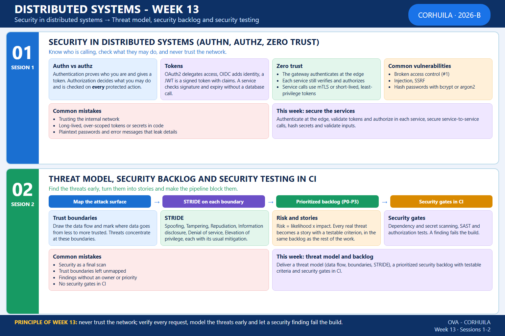

<!-- HU-STATUS TEMPLATE - do NOT remove the <!-- ... --> markers or the table headers.
     Your weekly grade is read AUTOMATICALLY from this file:
       13-week/hu-status/README.md  (inside YOUR fork). English. -->

# Weekly Status - Week 13

<!-- CONFIG-START - must match your profile repo (username/username) CONFIG -->
- FULL_NAME: Oscar Guillermo Sierra Lozano
- GITHUB_USER: Oscarsl10
- TEAM: CineSync Platform
- SPRINT_GOAL: Harden `csp-auth-api` after the audit of the norm (idempotency keys, explicit limits, structured logs, service credentials), run the threat-modeling workshop on the boundary `csp-api-gateway` to `csp-auth-api`, and build the first two security stories that came out of it (login lock audit and slowdown, stricter rate limit with the bound on password hashes).
<!-- CONFIG-END -->

## 1. User stories worked this week
| HU ID | Title | Status (todo/doing/done) | Evidence (PR or commit URL) |
|---|---|---|---|
| HU-AUTH-006 | Client Requests Password Reset (idempotency keys, explicit limits, audit fixes of the norm) | done | [csp-auth-api#182](https://github.com/code-corhuila/csp-auth-api/pull/182), [csp-auth-api#184](https://github.com/code-corhuila/csp-auth-api/pull/184), [csp-auth-api#185](https://github.com/code-corhuila/csp-auth-api/pull/185), [csp-auth-api#186](https://github.com/code-corhuila/csp-auth-api/pull/186), [csp-auth-api#187](https://github.com/code-corhuila/csp-auth-api/pull/187), [csp-auth-api#188](https://github.com/code-corhuila/csp-auth-api/pull/188), [csp-auth-api#189](https://github.com/code-corhuila/csp-auth-api/pull/189), [csp-auth-api#190](https://github.com/code-corhuila/csp-auth-api/pull/190), [csp-auth-api#191](https://github.com/code-corhuila/csp-auth-api/pull/191), [csp-auth-api#194](https://github.com/code-corhuila/csp-auth-api/pull/194), [csp-auth-api#196](https://github.com/code-corhuila/csp-auth-api/pull/196), [csp-auth-db#44](https://github.com/code-corhuila/csp-auth-db/pull/44), [csp-auth-db#45](https://github.com/code-corhuila/csp-auth-db/pull/45), [csp-auth-db#46](https://github.com/code-corhuila/csp-auth-db/pull/46), [csp-auth-db#47](https://github.com/code-corhuila/csp-auth-db/pull/47), [csp-auth-portal#88](https://github.com/code-corhuila/csp-auth-portal/pull/88), [csp-auth-portal#89](https://github.com/code-corhuila/csp-auth-portal/pull/89), [csp-docs#294](https://github.com/code-corhuila/csp-docs/pull/294), [csp-docs#295](https://github.com/code-corhuila/csp-docs/pull/295), [csp-docs#296](https://github.com/code-corhuila/csp-docs/pull/296) (the story is closed on the board) |
| W13-THREAT-MODEL | Threat model of the boundary `csp-api-gateway` to `csp-auth-api` (workshop, no HU) | done | [csp-docs#278](https://github.com/code-corhuila/csp-docs/pull/278) (open, waits for the team review) |
| W13-SECURITY-BACKLOG | Security stories [#280](https://github.com/code-corhuila/csp-docs/issues/280) (S), [#281](https://github.com/code-corhuila/csp-docs/issues/281) (D) and [#282](https://github.com/code-corhuila/csp-docs/issues/282) (I) | doing | #280 and #281 built and promoted to `qa`: [csp-auth-api#207](https://github.com/code-corhuila/csp-auth-api/pull/207), [csp-auth-api#208](https://github.com/code-corhuila/csp-auth-api/pull/208), [csp-auth-api#211](https://github.com/code-corhuila/csp-auth-api/pull/211), [csp-auth-api#212](https://github.com/code-corhuila/csp-auth-api/pull/212), [csp-auth-api#215](https://github.com/code-corhuila/csp-auth-api/pull/215), [csp-api-gateway#25](https://github.com/code-corhuila/csp-api-gateway/pull/25), [csp-api-gateway#26](https://github.com/code-corhuila/csp-api-gateway/pull/26), [csp-infra-postgres#37](https://github.com/code-corhuila/csp-infra-postgres/pull/37), [csp-infra-postgres#38](https://github.com/code-corhuila/csp-infra-postgres/pull/38), [csp-docs#311](https://github.com/code-corhuila/csp-docs/pull/311), [csp-docs#313](https://github.com/code-corhuila/csp-docs/pull/313), [csp-docs#314](https://github.com/code-corhuila/csp-docs/pull/314); #282 waits for the agreement of the team on the contract |

## 2. My individual contribution

Only my own work is listed; in the repositories shared with the team (`csp-api-gateway`, `csp-infra-*`) only the commits I authored are counted. The status of each story is the one of the board. Every pull request of the list is merged, except the STRIDE one.

- **Threat-modeling workshop** (in class on 2026-10-28, final delivery until 2026-10-30; folder [workshop](../workshop/README.md)): attack surface map with seven trust boundaries and nine assets ([01-attack-surface.md](../workshop/01-attack-surface.md)); STRIDE of the boundary `csp-api-gateway` to `csp-auth-api` in the team repository, seven threats ranked by risk, with the answer to the review of a teammate and the book *Hacking y seguridad en Internet* (García-Morán et al., 2nd ed., 2013, call number 0011099) with its pages ([csp-docs#278](https://github.com/code-corhuila/csp-docs/pull/278), commits [68a9fb8](https://github.com/code-corhuila/csp-docs/commit/68a9fb8), [b38bdb1](https://github.com/code-corhuila/csp-docs/commit/b38bdb1), [b7bbc56](https://github.com/code-corhuila/csp-docs/commit/b7bbc56), [1bf6fd9](https://github.com/code-corhuila/csp-docs/commit/1bf6fd9)); the claim issue [#275](https://github.com/code-corhuila/csp-docs/issues/275), the three security stories and a review comment on a teammate's STRIDE pull request ([csp-docs#277 review](https://github.com/code-corhuila/csp-docs/pull/277#pullrequestreview-5691705056)); the security gates and the negative test of the login ([04-security-ci](../workshop/04-security-ci/README.md)); and the reflection document. Fork commits: CP0 [d28ab59](https://github.com/Oscarsl10/sistemas-distribuidos-2026-b-g1/commit/d28ab59), CP1 [e0176bd](https://github.com/Oscarsl10/sistemas-distribuidos-2026-b-g1/commit/e0176bd), CP3 [eb628a0](https://github.com/Oscarsl10/sistemas-distribuidos-2026-b-g1/commit/eb628a0), CP4 [f14c995](https://github.com/Oscarsl10/sistemas-distribuidos-2026-b-g1/commit/f14c995), CP4 [5f559a4](https://github.com/Oscarsl10/sistemas-distribuidos-2026-b-g1/commit/5f559a4), CP4 [879d19f](https://github.com/Oscarsl10/sistemas-distribuidos-2026-b-g1/commit/879d19f), CP5 [794dd0b](https://github.com/Oscarsl10/sistemas-distribuidos-2026-b-g1/commit/794dd0b), CP7 [18d965a](https://github.com/Oscarsl10/sistemas-distribuidos-2026-b-g1/commit/18d965a), CP7 [d3f80bd](https://github.com/Oscarsl10/sistemas-distribuidos-2026-b-g1/commit/d3f80bd), CP8 [81a7292](https://github.com/Oscarsl10/sistemas-distribuidos-2026-b-g1/commit/81a7292), CP9 [ff01038](https://github.com/Oscarsl10/sistemas-distribuidos-2026-b-g1/commit/ff01038).
- **Security story #280, failed logins**: every lock of the login is recorded as an audit event ([csp-auth-api#207](https://github.com/code-corhuila/csp-auth-api/pull/207)) and a second counter slows the failed logins of one email without locking the account ([csp-auth-api#208](https://github.com/code-corhuila/csp-auth-api/pull/208)), decided in ADR-059 ([csp-docs#311](https://github.com/code-corhuila/csp-docs/pull/311)).
- **Security story #281, rate limit and hashes**: the gateway has its own stricter limit for login, register and forgot-password ([csp-api-gateway#25](https://github.com/code-corhuila/csp-api-gateway/pull/25)), the service bounds the concurrent password hashes ([csp-auth-api#211](https://github.com/code-corhuila/csp-auth-api/pull/211)) and exports the latency and outcome of every route on `/metrics` ([csp-auth-api#212](https://github.com/code-corhuila/csp-auth-api/pull/212)), and the platform scrapes `csp-auth-api` and alerts on the latency of login and register ([csp-infra-postgres#37](https://github.com/code-corhuila/csp-infra-postgres/pull/37)); decisions in ADR-060 and ADR-061 ([csp-docs#313](https://github.com/code-corhuila/csp-docs/pull/313), [csp-docs#314](https://github.com/code-corhuila/csp-docs/pull/314)). All of it promoted to `qa` ([csp-auth-api#215](https://github.com/code-corhuila/csp-auth-api/pull/215), [csp-api-gateway#26](https://github.com/code-corhuila/csp-api-gateway/pull/26), [csp-infra-postgres#38](https://github.com/code-corhuila/csp-infra-postgres/pull/38)).
- **Idempotency keys**: `forgot-password` requires an `Idempotency-Key` in the service, the table of its keys and the portal ([csp-auth-api#182](https://github.com/code-corhuila/csp-auth-api/pull/182), [csp-auth-db#44](https://github.com/code-corhuila/csp-auth-db/pull/44), [csp-auth-portal#88](https://github.com/code-corhuila/csp-auth-portal/pull/88), [csp-docs#294](https://github.com/code-corhuila/csp-docs/pull/294)), and the email change request stores its key ([csp-auth-api#190](https://github.com/code-corhuila/csp-auth-api/pull/190), [csp-auth-db#46](https://github.com/code-corhuila/csp-auth-db/pull/46), [csp-docs#295](https://github.com/code-corhuila/csp-docs/pull/295)); promoted to `qa` ([csp-auth-api#184](https://github.com/code-corhuila/csp-auth-api/pull/184), [csp-auth-api#194](https://github.com/code-corhuila/csp-auth-api/pull/194), [csp-auth-db#45](https://github.com/code-corhuila/csp-auth-db/pull/45), [csp-auth-db#47](https://github.com/code-corhuila/csp-auth-db/pull/47), [csp-auth-portal#89](https://github.com/code-corhuila/csp-auth-portal/pull/89)).
- **Audit of the norm in `csp-auth-api`**: explicit request limits and a bound on register and login ([csp-auth-api#189](https://github.com/code-corhuila/csp-auth-api/pull/189)), a root wrapper with correlation id, enveloped `404` and `405` and panic recovery ([csp-auth-api#188](https://github.com/code-corhuila/csp-auth-api/pull/188)), structured JSON logs with the trace id and one access line per request ([csp-auth-api#191](https://github.com/code-corhuila/csp-auth-api/pull/191)), the `429` with the code `TOO_MANY_REQUESTS` of the norm, ADR-055 ([csp-auth-api#196](https://github.com/code-corhuila/csp-auth-api/pull/196), [csp-docs#296](https://github.com/code-corhuila/csp-docs/pull/296)), users listed from newest to oldest ([csp-auth-api#187](https://github.com/code-corhuila/csp-auth-api/pull/187)), and tests of invalid user tokens over HTTP on the protected routes ([csp-auth-api#186](https://github.com/code-corhuila/csp-auth-api/pull/186)); promoted to `qa` ([csp-auth-api#183](https://github.com/code-corhuila/csp-auth-api/pull/183), [csp-auth-api#192](https://github.com/code-corhuila/csp-auth-api/pull/192), [csp-auth-api#193](https://github.com/code-corhuila/csp-auth-api/pull/193), [csp-auth-api#195](https://github.com/code-corhuila/csp-auth-api/pull/195), [csp-auth-api#197](https://github.com/code-corhuila/csp-auth-api/pull/197)).
- **Service credentials**: they must carry issuer and audience (ADR-056, [csp-auth-api#198](https://github.com/code-corhuila/csp-auth-api/pull/198), [csp-auth-api#199](https://github.com/code-corhuila/csp-auth-api/pull/199), [csp-auth-api#200](https://github.com/code-corhuila/csp-auth-api/pull/200), [csp-auth-api#201](https://github.com/code-corhuila/csp-auth-api/pull/201), [csp-auth-api#202](https://github.com/code-corhuila/csp-auth-api/pull/202), [csp-docs#297](https://github.com/code-corhuila/csp-docs/pull/297), [csp-docs#298](https://github.com/code-corhuila/csp-docs/pull/298), [csp-infra-postgres#29](https://github.com/code-corhuila/csp-infra-postgres/pull/29), [csp-infra-postgres#30](https://github.com/code-corhuila/csp-infra-postgres/pull/30)).
- **Development mail relay**: a profile that relays Mailpit to a real provider, with its script and variables, and the documentation of what it does when the provider is unreachable or slow ([csp-auth-api#203](https://github.com/code-corhuila/csp-auth-api/pull/203), [csp-auth-api#204](https://github.com/code-corhuila/csp-auth-api/pull/204), [csp-auth-api#205](https://github.com/code-corhuila/csp-auth-api/pull/205), [csp-auth-api#206](https://github.com/code-corhuila/csp-auth-api/pull/206), [csp-infra-postgres#31](https://github.com/code-corhuila/csp-infra-postgres/pull/31), [csp-infra-postgres#32](https://github.com/code-corhuila/csp-infra-postgres/pull/32), [csp-infra-postgres#33](https://github.com/code-corhuila/csp-infra-postgres/pull/33), [csp-infra-postgres#34](https://github.com/code-corhuila/csp-infra-postgres/pull/34), [csp-infra-postgres#35](https://github.com/code-corhuila/csp-infra-postgres/pull/35)).
- **Test stability**: the delivery test of the password-reset sender no longer depends on the speed of the machine ([csp-auth-api#185](https://github.com/code-corhuila/csp-auth-api/pull/185)).
- **Session activities (not applied to the project)**: [session 1](../01-session/README.md), a rehearsal of authentication, authorization and zero trust on my machine with a stand-in of the gateway and of `csp-auth-api` (11 tests, and a check that they catch a weak verifier), with the answers of the self-check and a read of where the project stands; and [session 2](../02-session/README.md), the plan of the security gates for MVP 3 over the threat model and the backlog of the workshop.
- Full commit log of the week: [commits.md](commits.md).

## 3. Blockers and risks

- GitHub Actions is still locked by billing since 2026-10-14: the pull requests of the week were validated locally with the steps of each repository workflow, and CI evidence is missing for them. The security gates of the workshop (`security.yml`) have not run in GitHub either.
- The STRIDE pull request [csp-docs#278](https://github.com/code-corhuila/csp-docs/pull/278) is open and waits for the review and the merge of the team; I do not merge it.
- Story #282 changes the `POST /register` contract and needs the agreement of the team before it is built.
- The eight 3.0.0 release pull requests (`csp-auth-api#83`, `csp-auth-db#33`, `csp-auth-portal#49`, `csp-front#61`, `csp-api-gateway#6`, `csp-infra-redis#9`, `csp-infra-postgres#15`, `csp-worker#24`) are still open and need the approval of the professor and of the leader.
- The end-to-end test of the login lock against PostgreSQL and Redis was not run for the workshop, and the names of the real tests do not contain `Authz`, so the job `authz-tests` would not select them in `csp-auth-api` yet.

## 4. Plan for next week

- Build story #282 once the team approves the change of the `POST /register` contract, and close #280 and #281 on the board with their evidence when the review of the team is done.
- Put the security gates of session 2 (`govulncheck`, `gitleaks`, `gosec`, the `Authz` tests) in the pipeline of `csp-auth-api` when the Actions run again, and decide the tools of the other repositories in an ADR.
- Keep the 3.0.0 releases up to date with every story that reaches `qa`.

## 5. Compliance self-check

- [x] Conventional Commits - `type(scope): summary`
- [x] Per-environment HU branch + PR to that environment (code repos: child branch -> `develop`; `csp-docs`: `docs/* -> main`). The STRIDE branch follows the workshop name `security/stride-<user>`.
- [x] Testable acceptance criteria
- [x] Tests added/updated (unit / integration). Each pull request of the week carries its tests: for the lock audit, the slowdown per account, the hash bound and the metrics in `csp-auth-api` (unit and integration), the smoke check of the gateway, the test of the latency alert, four negative authorization tests of the workshop and eleven tests of the session 1 rehearsal.
- [x] DDD / hexagonal boundaries respected (domain has no I/O)
- [x] No secrets; config via environment variables

## 6. Evidence links

- [Week 13 Full Commit Log](commits.md)
- [Session 1: authentication, authorization and zero trust](../01-session/README.md)
- [Session 2: threat model, backlog and security testing](../02-session/README.md)
- [Workshop folder](../workshop/README.md)
- [Pull request csp-docs#278](https://github.com/code-corhuila/csp-docs/pull/278)
- [Claim issue csp-docs#275](https://github.com/code-corhuila/csp-docs/issues/275)
- Security stories: [#280](https://github.com/code-corhuila/csp-docs/issues/280), [#281](https://github.com/code-corhuila/csp-docs/issues/281), [#282](https://github.com/code-corhuila/csp-docs/issues/282)
- [Repository: csp-docs](https://github.com/code-corhuila/csp-docs)
- [Repository: csp-auth-api](https://github.com/code-corhuila/csp-auth-api)
- [Repository: csp-auth-db](https://github.com/code-corhuila/csp-auth-db)
- [Repository: csp-auth-portal](https://github.com/code-corhuila/csp-auth-portal)
- [Repository: csp-api-gateway](https://github.com/code-corhuila/csp-api-gateway)
- [Repository: csp-infra-postgres](https://github.com/code-corhuila/csp-infra-postgres)
- Week 13 summary session 1-2:

  
