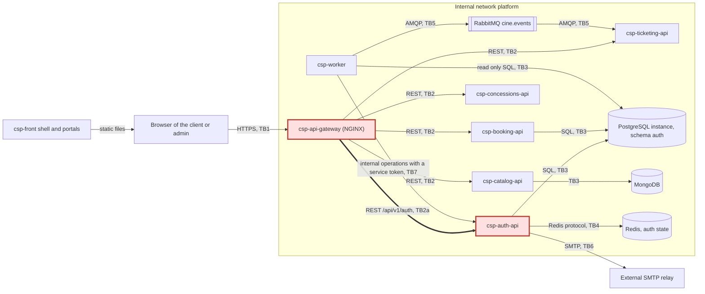

# CP1 - Attack surface map

My boundary: **TB2a, `csp-api-gateway` to `csp-auth-api`** (requests under `/api/v1/auth`). Real elements used here: the services
`csp-api-gateway` and `csp-auth-api`, the tables `app_user`, `user_role`, `refresh_token`, `email_verification`, `idempotency_key`, the event
`UserRegistered` and the routes of the contract `auth-service.yaml`. Sources read: `csp-docs` (`09-microservices`, ADR-029, ADR-033, ADR-040,
ADR-048), `csp-api-gateway` (`nginx/routes/auth.conf`, `nginx/conf.d/20-server.conf`, `nginx/templates/10-security.conf.template`) and
`csp-auth-api` (`internal/adapter/in/httpapi`).

## 1. Data flow and trust boundaries

| Boundary | Between | Why it is a trust boundary |
|---|---|---|
| TB1 | Internet and `csp-api-gateway` | Anyone can send any request; only the gateway is published to the host (port 8000). |
| **TB2a (mine)** | `csp-api-gateway` and `csp-auth-api` | The gateway checks only that an `Authorization` header exists; the service validates the token itself. |
| TB2 | `csp-api-gateway` and the other domain APIs | Same pattern, analysed by teammates (Booking in issue #274). |
| TB3 | Services and PostgreSQL or MongoDB | One login per domain; the worker reads the outbox with its own login. |
| TB4 | `csp-auth-api` and Redis | The `auth_app` user of Redis has a short list of commands. |
| TB5 | `csp-worker` / consumers and RabbitMQ | One login per domain with least privilege (ADR-036). |
| TB6 | `csp-auth-api` and the SMTP relay | The verification code leaves the platform. |
| TB7 | `csp-worker` and the internal operations of `csp-auth-api` | A service token with `sub` `csp-worker`; the gateway answers 404 for `/internal`. |

## 2. Asset inventory (classification is my own assessment)

| Asset | Where it lives | In transit | Classification |
|---|---|---|---|
| Password hash (bcrypt) | `app_user` in PostgreSQL | never leaves `csp-auth-api` | Restricted |
| Refresh token and its rotation record | `refresh_token` in PostgreSQL | `POST /login`, `/register`, `/refresh` answers | Restricted |
| RS256 signing key | Secret of the environment, read by `csp-auth-api` | never; the public key is published at `GET /jwks` | Restricted |
| Access token (15 minutes) | Browser memory, `Authorization` header | every protected route, through the gateway | Confidential |
| Email, phone, address | `app_user`; phone and address are never returned nor published (ADR-024) | `POST /register`, `PATCH /me`, `PATCH /me/email` | Confidential |
| Role assignments | `user_role` | `PATCH /users/{userId}/role`, claims of the token | Confidential (integrity is the critical part) |
| Verification code of the email change | `email_verification`, SMTP relay | SMTP to the user | Restricted, short lived |
| Failed-login counters and locks per IP | Redis `attempts:{ip}`, `locked:{ip}` | `csp-auth-api` to Redis | Internal |
| `UserRegistered` event | `auth.outbox_event`, RabbitMQ | relay to the broker, `cine.auth.user-registered.v1` | Confidential (carries the email) |

## 3. Entry points of the boundary (gateway to `csp-auth-api`)

Rate limit of the gateway for every route: 10 requests per second per client IP, burst of 20, answer `429`. The gateway drops any
`X-User-Id` and `X-User-Roles` the client sends and answers one `X-Correlation-Id`.

| Entry point | Who calls it | How it authenticates today |
|---|---|---|
| `POST /register` (with `Idempotency-Key`) | Visitor, portal | None. The `Idempotency-Key` makes it repeatable. |
| `POST /login` | Visitor, portal | Credentials; 10 failed attempts per client IP in 5 minutes lock that IP for 5 minutes (ADR-040), `429 RATE_LIMITED`. |
| `POST /refresh` | Signed-in browser | Refresh token; a reused one revokes the sessions of the user (ADR-029). |
| `POST /forgot-password`, `POST /reset-password` | Visitor | None / reset token; the current password is rejected on reset. |
| `GET /jwks`, `GET /health`, `GET /health/ready` | Any service, monitoring | None (public). |
| `POST /logout` | Signed-in user | Bearer token; the token id goes to the revoked list in Redis (ADR-033). |
| `GET /me`, `PATCH /me`, `POST /me/password`, `PATCH /me/email`, `POST /me/email/verify` | Signed-in user | Bearer token validated by `csp-auth-api`. |
| `GET /users`, `PATCH /users/{userId}/role` | Administrator | Bearer token whose permission is checked per route (`requirePermission`), ADMIN only. |
| `/internal/...` | `csp-worker` only | Not routed by the gateway (404); the worker calls the service directly with a service token. |

Public routes need no `Authorization` header. For the protected ones the gateway only checks that the header is not empty
(`require-auth.conf`), and says in its own comment that this is not a validation of the token.
