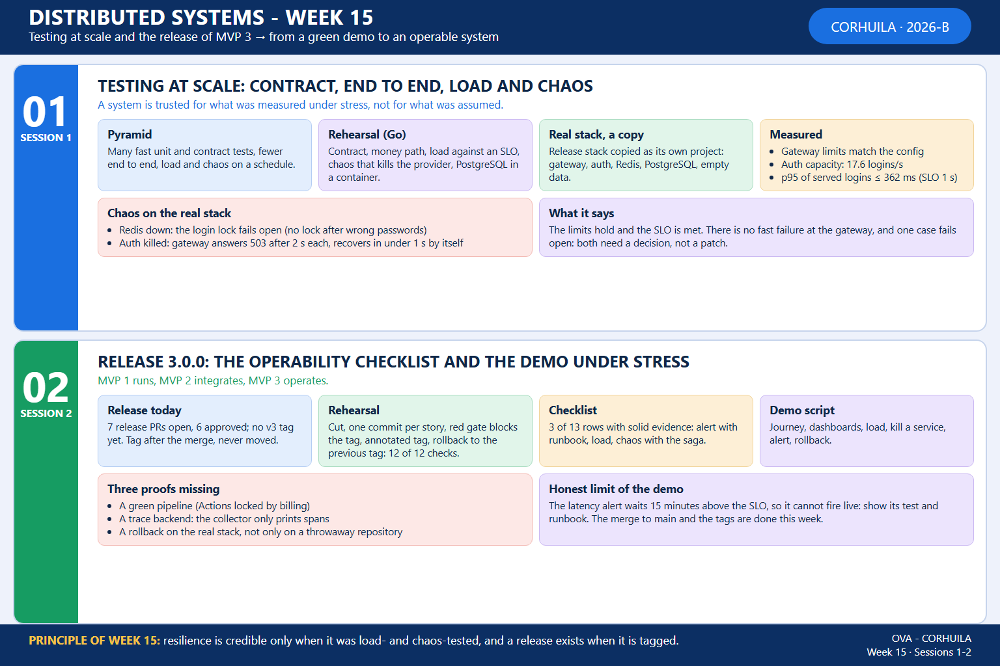

<!-- HU-STATUS TEMPLATE - do NOT remove the <!-- ... --> markers or the table headers.
     Your weekly grade is read AUTOMATICALLY from this file:
       15-week/hu-status/README.md  (inside YOUR fork). English. -->

# Weekly Status - Week 15

<!-- CONFIG-START - must match your profile repo (username/username) CONFIG -->
- FULL_NAME: Oscar Guillermo Sierra Lozano
- GITHUB_USER: Oscarsl10
- TEAM: CineSync Platform
- SPRINT_GOAL: Present MVP 3 (release 3.0.0), keep the Ticketing purchase flow working from the booking to the ticket email, accept the security and ticketing decisions as ADRs, and back the release with tests at scale (contract, end to end, load and chaos), leaving the merge to `main` and the `v3.0.0` tags for the end of the week.
<!-- CONFIG-END -->

## 1. User stories worked this week
| HU ID | Title | Status (todo/doing/done) | Evidence (PR or commit URL) |
|---|---|---|---|
| HU-TICKETING-002 | Ticket Is Issued and Emailed After Confirmation | doing | Merged to `develop` and promoted to `qa`: [csp-ticketing-api#85](https://github.com/code-corhuila/csp-ticketing-api/pull/85) and [#86](https://github.com/code-corhuila/csp-ticketing-api/pull/86) (the email link points to the shell), [csp-infra-postgres#74](https://github.com/code-corhuila/csp-infra-postgres/pull/74) and [#75](https://github.com/code-corhuila/csp-infra-postgres/pull/75) (the development example turns on the worker jobs that issue the ticket). ADR-057 and ADR-058 accepted in [csp-docs#373](https://github.com/code-corhuila/csp-docs/pull/373). Release 3.0.0 pending: [csp-ticketing-api#84](https://github.com/code-corhuila/csp-ticketing-api/pull/84) |
| HU-FE-TICKETING-002 | Frontend Shows My Tickets From the Ticketing API | done | Merged to `develop` and promoted to `qa`: [csp-front#78](https://github.com/code-corhuila/csp-front/pull/78) and [#79](https://github.com/code-corhuila/csp-front/pull/79) (the shell redirects `/dashboard/tickets` to `/dashboard`, where "Mis boletas" lives, so the link of the ticket email no longer ends in the 404 page). Story [csp-docs#352](https://github.com/code-corhuila/csp-docs/issues/352) closed |
| HU-TICKETING-005 | Hold expiry reminder and notifications | doing | ADR-068 accepted in [csp-docs#373](https://github.com/code-corhuila/csp-docs/pull/373). Release 3.0.0 pending: [csp-ticketing-api#84](https://github.com/code-corhuila/csp-ticketing-api/pull/84) |
| HU-AUTH-001, HU-AUTH-002, HU-AUTH-005 | Registration, sign-in and lock of the credentials (auth service) | doing | ADR-060 accepted in [csp-docs#373](https://github.com/code-corhuila/csp-docs/pull/373); ADR-059, ADR-061 and ADR-062 accepted in [csp-docs#374](https://github.com/code-corhuila/csp-docs/pull/374). Release 3.0.0 pending: [csp-auth-api#83](https://github.com/code-corhuila/csp-auth-api/pull/83), [csp-auth-db#33](https://github.com/code-corhuila/csp-auth-db/pull/33), [csp-auth-portal#49](https://github.com/code-corhuila/csp-auth-portal/pull/49) (all approved) |
| No HU ID (security workshop) | Threat model of the boundary `csp-api-gateway` to `csp-auth-api` ([csp-docs#275](https://github.com/code-corhuila/csp-docs/issues/275)) | done | Merged on 2026-11-08: [csp-docs#278](https://github.com/code-corhuila/csp-docs/pull/278). Story closed. The matching threat model of the ticketing boundary is [csp-docs#290](https://github.com/code-corhuila/csp-docs/pull/290) |
| No HU ID (documentation) | BPMN diagram of the core purchase flow (DIAG-BPMN-01) | doing | Open: [csp-docs#375](https://github.com/code-corhuila/csp-docs/pull/375), not merged yet |

## 2. My individual contribution

Only my own work is listed. Repositories shared with the team (`csp-front`, `csp-infra-*`) count only my commits and pull requests. This is a partial week: the data was taken on 2026-11-11, and the merge of release 3.0.0 to `main` and the tags are still to be done this week.

- **MVP 3 presented.** The team presented MVP 3 (release 3.0.0) today. The release pull requests are open, and six of the seven I checked on GitHub are approved: [csp-auth-api#83](https://github.com/code-corhuila/csp-auth-api/pull/83), [csp-auth-db#33](https://github.com/code-corhuila/csp-auth-db/pull/33), [csp-auth-portal#49](https://github.com/code-corhuila/csp-auth-portal/pull/49), [csp-booking-api#61](https://github.com/code-corhuila/csp-booking-api/pull/61), [csp-workflow#26](https://github.com/code-corhuila/csp-workflow/pull/26) and [csp-api-gateway#6](https://github.com/code-corhuila/csp-api-gateway/pull/6). [csp-ticketing-api#84](https://github.com/code-corhuila/csp-ticketing-api/pull/84) still needs its review. No repository has a `v3` tag yet.
- **Ticket email link and the purchase chain.** I found two causes of a broken ticket in development and fixed both in `develop` and `qa`: the link of the email ended at a 404 page because it pointed to a portal with no session ([csp-ticketing-api#85](https://github.com/code-corhuila/csp-ticketing-api/pull/85), [csp-front#78](https://github.com/code-corhuila/csp-front/pull/78), promoted in [#86](https://github.com/code-corhuila/csp-ticketing-api/pull/86) and [#79](https://github.com/code-corhuila/csp-front/pull/79)); and in development a confirmed reservation never produced a ticket because the worker jobs were off ([csp-infra-postgres#74](https://github.com/code-corhuila/csp-infra-postgres/pull/74), promoted in [#75](https://github.com/code-corhuila/csp-infra-postgres/pull/75)). The `qa` and `main` examples keep every job flag off: turning those jobs on there is an environment decision.
- **Seven decisions accepted as ADRs.** ADR-057, ADR-058, ADR-060 and ADR-068 ([csp-docs#373](https://github.com/code-corhuila/csp-docs/pull/373)); ADR-059, ADR-061 and ADR-062 ([csp-docs#374](https://github.com/code-corhuila/csp-docs/pull/374)). Each moves from Proposed to Accepted, because their implementation is already in `develop` (the second pull request also fixes a note of ADR-061 that said ADR-060 was not accepted yet).
- **Threat models.** The threat model of the boundary gateway to auth ([csp-docs#278](https://github.com/code-corhuila/csp-docs/pull/278)) and the one of the ticketing boundary ([csp-docs#290](https://github.com/code-corhuila/csp-docs/pull/290)) were merged on 2026-11-08.
- **BPMN of the purchase flow.** I drew the whole business process across the participants (client, administrator, one lane per service, the `book-seats` saga and the external systems), built from the code and the accepted ADRs: [csp-docs#375](https://github.com/code-corhuila/csp-docs/pull/375), open.
- **Certification study log (not an HU).** Chapter 10 on 2026-11-09 (3.00 h) and chapter 11 on 2026-11-11 (3.00 h), with their evidence, in the certification folder of the fork.
- **Session 1: testing at scale.** Contract, end to end, load and chaos, written as a report with a Go rehearsal and an integration test with Testcontainers ([01-session](../01-session/README.md)). I also ran load and chaos on a **copy of the release stack** (the original was stopped and kept intact, and the copy was removed afterwards), and the scripts are in [real-stack](../01-session/real-stack/). Results: the limits of the gateway match its configuration; `csp-auth-api` serves about 17.6 logins per second; the p95 of the logins served stayed at most 362 ms against the 1 s SLO; with Redis stopped the lock of the login fails open; with `csp-auth-api` killed the gateway answers `503` after 2 s and recovers by itself in under 1 s. Nothing from it is applied to the project.
- **Session 2: release and operability checklist.** A rehearsal of the cut, the gate, the tag and the rollback (12 of 12 checks, on a throwaway repository), the checklist of the page read against the project (3 of 13 rows with solid evidence), a demo script and the retrospective ([02-session](../02-session/README.md)). Nothing from it is applied to the project either.

## 3. Blockers and risks

- The release is not merged and not tagged yet. The six approved release pull requests have the merge state `UNSTABLE` because GitHub Actions is locked by billing since 2026-10-14, so no check runs. Each one will be merged only with its own explicit authorization, after a local validation of the workflow steps, in the order database, API, portal, and tagged after the merge (a tag is never moved).
- [csp-ticketing-api#84](https://github.com/code-corhuila/csp-ticketing-api/pull/84) needs its review before the Ticketing release can be merged.
- Three proofs of the MVP 3 checklist are missing (session 2): a green pipeline, a trace backend (the collector of `csp-infra-postgres` only prints spans, it has no store), and a rollback tried on the real stack.
- Findings of the tests at scale that need a decision, not a patch: with Redis down the credential lock fails open, and there is no breaker at the gateway, so a dead service costs 2 s per request.
- The latency alert takes 15 minutes above the SLO to fire, so it cannot be shown firing in a short demo; its test and its runbook can.
- The coverage floor and the secret and dependency scans were missing in the workflows I read in week 14; I did not read them again this week.

## 4. Plan for next week

- **Still this week (week 15):** merge release 3.0.0 to `main` pull request by pull request, each with its own authorization, and create the `v3.0.0` tags after the merges. Then update the session 2 report with the real state of the tags, close the HU issues of the release and delete the release branches and their worktrees.
- **Next week (week 16):** take the findings of session 1 to the team to decide: the fail-open case of the lock, a fast failure at the gateway, and a store for the traces.
- **Next week (week 16):** prepare the final presentation and documentation of week 16 with the retrospective of session 2.

## 5. Compliance self-check

- [x] Conventional Commits - `type(scope): summary`
- [x] Per-environment HU branch + PR to that environment (code repos: child branch -> `develop`, then promotion to `qa`; `csp-docs`: `docs/* -> main`)
- [x] Testable acceptance criteria
- [x] Tests added/updated (unit / integration) - the fixes of the week ran the steps of their workflow locally and the rehearsals of the sessions ship their tests
- [x] DDD / hexagonal boundaries respected (domain has no I/O)
- [x] No secrets; config via environment variables

## 6. Evidence links

- [Session 1: testing at scale (contract, end to end, load and chaos)](../01-session/README.md)
- [Session 2: release, operability checklist and retrospective](../02-session/README.md)
- [Repository: csp-ticketing-api](https://github.com/code-corhuila/csp-ticketing-api)
- [Repository: csp-auth-api](https://github.com/code-corhuila/csp-auth-api)
- [Repository: csp-front](https://github.com/code-corhuila/csp-front)
- [Repository: csp-docs](https://github.com/code-corhuila/csp-docs)
- Full commit log of the week: [commits.md](commits.md).
- Week 15 summary session 1-2:

  
- [Week 14 status](../../14-week/hu-status/README.md)
