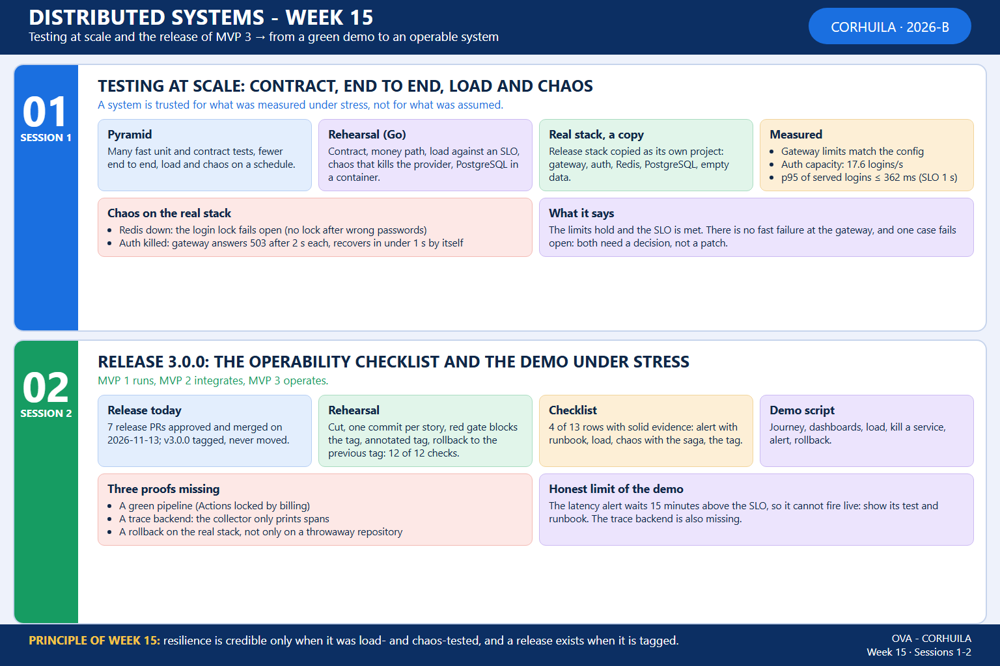

<!-- HU-STATUS TEMPLATE - do NOT remove the <!-- ... --> markers or the table headers.
     Your weekly grade is read AUTOMATICALLY from this file:
       15-week/hu-status/README.md  (inside YOUR fork). English. -->

# Weekly Status - Week 15

<!-- CONFIG-START - must match your profile repo (username/username) CONFIG -->
- FULL_NAME: Oscar Guillermo Sierra Lozano
- GITHUB_USER: Oscarsl10
- TEAM: CineSync Platform
- SPRINT_GOAL: Present MVP 3 (release 3.0.0), merge it to `main` and tag `v3.0.0`, keep the Ticketing purchase flow working from the booking to the ticket email, accept the security and ticketing decisions as ADRs, back the release with tests at scale (contract, end to end, load and chaos), and bring the documentation of the platform up to the state of the tag.
<!-- CONFIG-END -->

## 1. User stories worked this week
| HU ID | Title | Status (todo/doing/done) | Evidence (PR or commit URL) |
|---|---|---|---|
| HU-TICKETING-002 | Ticket Is Issued and Emailed After Confirmation | done | Fixes merged to `develop` and promoted to `qa`: [csp-ticketing-api#85](https://github.com/code-corhuila/csp-ticketing-api/pull/85) and [#86](https://github.com/code-corhuila/csp-ticketing-api/pull/86) (the email link points to the shell), [csp-infra-postgres#74](https://github.com/code-corhuila/csp-infra-postgres/pull/74) and [#75](https://github.com/code-corhuila/csp-infra-postgres/pull/75) (the development example turns on the worker jobs that issue the ticket). ADR-057 and ADR-058 accepted in [csp-docs#373](https://github.com/code-corhuila/csp-docs/pull/373). In `main` through the release: [csp-ticketing-api#84](https://github.com/code-corhuila/csp-ticketing-api/pull/84), tag `v3.0.0` |
| HU-FE-TICKETING-002 | Frontend Shows My Tickets From the Ticketing API | done | Merged to `develop` and promoted to `qa`: [csp-front#78](https://github.com/code-corhuila/csp-front/pull/78) and [#79](https://github.com/code-corhuila/csp-front/pull/79) (the shell redirects `/dashboard/tickets` to `/dashboard`, where "Mis boletas" lives, so the link of the ticket email no longer ends in the 404 page). Story [csp-docs#352](https://github.com/code-corhuila/csp-docs/issues/352) closed |
| HU-TICKETING-005 | Hold expiry reminder and notifications | done | ADR-068 accepted in [csp-docs#373](https://github.com/code-corhuila/csp-docs/pull/373). In `main` through the release: [csp-ticketing-api#84](https://github.com/code-corhuila/csp-ticketing-api/pull/84), tag `v3.0.0` |
| HU-AUTH-001, HU-AUTH-002, HU-AUTH-005 | Registration, sign-in and lock of the credentials (auth service) | done | ADR-060 accepted in [csp-docs#373](https://github.com/code-corhuila/csp-docs/pull/373); ADR-059, ADR-061 and ADR-062 accepted in [csp-docs#374](https://github.com/code-corhuila/csp-docs/pull/374). In `main` through the release: [csp-auth-api#83](https://github.com/code-corhuila/csp-auth-api/pull/83), [csp-auth-db#33](https://github.com/code-corhuila/csp-auth-db/pull/33), [csp-auth-portal#49](https://github.com/code-corhuila/csp-auth-portal/pull/49), tag `v3.0.0` |
| HU-CONCESSIONS-004 | Book seats as a saga (workflow service) | done | In `main` through the release: [csp-workflow#26](https://github.com/code-corhuila/csp-workflow/pull/26), [csp-booking-api#61](https://github.com/code-corhuila/csp-booking-api/pull/61) (the internal routes of the workflow service), tag `v3.0.0` (the work of the service was done in week 14) |
| No HU ID (release) | Release 3.0.0 merged to `main` and tagged `v3.0.0` | done | Seven release pull requests merged on 2026-11-13 (local time): [csp-auth-db#33](https://github.com/code-corhuila/csp-auth-db/pull/33), [csp-auth-api#83](https://github.com/code-corhuila/csp-auth-api/pull/83), [csp-auth-portal#49](https://github.com/code-corhuila/csp-auth-portal/pull/49), [csp-booking-api#61](https://github.com/code-corhuila/csp-booking-api/pull/61), [csp-workflow#26](https://github.com/code-corhuila/csp-workflow/pull/26), [csp-api-gateway#6](https://github.com/code-corhuila/csp-api-gateway/pull/6), [csp-ticketing-api#84](https://github.com/code-corhuila/csp-ticketing-api/pull/84). The tag `v3.0.0` exists in each of them and in the other repositories of the release. Stories moved to Done: [csp-docs#379](https://github.com/code-corhuila/csp-docs/pull/379), [#380](https://github.com/code-corhuila/csp-docs/pull/380) |
| No HU ID (security workshop) | Threat model of the boundary `csp-api-gateway` to `csp-auth-api` ([csp-docs#275](https://github.com/code-corhuila/csp-docs/issues/275)) | done | Merged on 2026-11-08: [csp-docs#278](https://github.com/code-corhuila/csp-docs/pull/278). Story closed. The matching threat model of the ticketing boundary is [csp-docs#290](https://github.com/code-corhuila/csp-docs/pull/290) |
| No HU ID (documentation) | BPMN diagram of the core purchase flow (DIAG-BPMN-01) | done | Merged: [csp-docs#375](https://github.com/code-corhuila/csp-docs/pull/375) |
| No HU ID (documentation) | Documentation of the platform at the state of `v3.0.0`: README, DevOps statements, start procedure, onboarding, runbooks and test report | done | Merged: [csp-docs#384](https://github.com/code-corhuila/csp-docs/pull/384) and [#386](https://github.com/code-corhuila/csp-docs/pull/386) (project README), [#385](https://github.com/code-corhuila/csp-docs/pull/385) (statements that still described the platform as design only), [#399](https://github.com/code-corhuila/csp-docs/pull/399) (verified start procedure with `up.sh`), [#401](https://github.com/code-corhuila/csp-docs/pull/401) (technical onboarding), [#402](https://github.com/code-corhuila/csp-docs/pull/402) (runbooks of `csp-worker`, `csp-workflow` and `csp-front`), [#406](https://github.com/code-corhuila/csp-docs/pull/406) (test report of `v3.0.0`), [#407](https://github.com/code-corhuila/csp-docs/pull/407) (closes TD-031) |

## 2. My individual contribution

Only my own work is listed. Repositories shared with the team (`csp-front`, `csp-infra-*`) count only my commits and pull requests. The week runs from 2026-11-08 to 2026-11-14 and the data was taken on 2026-11-14.

- **MVP 3 presented, release merged and tagged.** The team presented MVP 3 (release 3.0.0) on 2026-11-11. The seven release pull requests of the table were then merged to `main` on 2026-11-13 (local time) and `v3.0.0` was tagged; I checked the seven tags with the tags API on 2026-11-14. In `csp-docs`, the story file moves 28 stories to Done, which is the state of a story promoted to `main`, and keeps three stories as they were because no release pull request cites them ([csp-docs#379](https://github.com/code-corhuila/csp-docs/pull/379), [#380](https://github.com/code-corhuila/csp-docs/pull/380)).
- **Ticket email link and the purchase chain.** I found two causes of a broken ticket in development and fixed both in `develop` and `qa`: the link of the email ended at a 404 page because it pointed to a portal with no session ([csp-ticketing-api#85](https://github.com/code-corhuila/csp-ticketing-api/pull/85), [csp-front#78](https://github.com/code-corhuila/csp-front/pull/78), promoted in [#86](https://github.com/code-corhuila/csp-ticketing-api/pull/86) and [#79](https://github.com/code-corhuila/csp-front/pull/79)); and in development a confirmed reservation never produced a ticket because the worker jobs were off ([csp-infra-postgres#74](https://github.com/code-corhuila/csp-infra-postgres/pull/74), promoted in [#75](https://github.com/code-corhuila/csp-infra-postgres/pull/75)). The `qa` and `main` examples keep every job flag off: turning those jobs on there is an environment decision.
- **Seven decisions accepted as ADRs.** ADR-057, ADR-058, ADR-060 and ADR-068 ([csp-docs#373](https://github.com/code-corhuila/csp-docs/pull/373)); ADR-059, ADR-061 and ADR-062 ([csp-docs#374](https://github.com/code-corhuila/csp-docs/pull/374)). Each moves from Proposed to Accepted, because their implementation is already in `develop` (the second pull request also fixes a note of ADR-061 that said ADR-060 was not accepted yet).
- **Threat models.** The threat model of the boundary gateway to auth ([csp-docs#278](https://github.com/code-corhuila/csp-docs/pull/278)) and the one of the ticketing boundary ([csp-docs#290](https://github.com/code-corhuila/csp-docs/pull/290)) were merged on 2026-11-08.
- **BPMN of the purchase flow.** I drew the whole business process across the participants (client, administrator, one lane per service, the `book-seats` saga and the external systems), built from the code and the accepted ADRs ([csp-docs#375](https://github.com/code-corhuila/csp-docs/pull/375), merged).
- **Documentation at the state of the tag.** After the release I brought `csp-docs` up to what the platform is at `v3.0.0`: the project README replaced the template one ([csp-docs#384](https://github.com/code-corhuila/csp-docs/pull/384), [#386](https://github.com/code-corhuila/csp-docs/pull/386)); statements that still described the platform as design only were corrected ([#385](https://github.com/code-corhuila/csp-docs/pull/385)); the procedure to start the platform with `up.sh` was written from a run ([#399](https://github.com/code-corhuila/csp-docs/pull/399)); the onboarding reference was corrected ([#401](https://github.com/code-corhuila/csp-docs/pull/401)); the runbooks of `csp-worker`, `csp-workflow` and `csp-front` were added ([#402](https://github.com/code-corhuila/csp-docs/pull/402)); TD-031 was closed because RabbitMQ is in the platform composition ([#407](https://github.com/code-corhuila/csp-docs/pull/407)). No code repository was modified.
- **Test report of the release.** [csp-docs#406](https://github.com/code-corhuila/csp-docs/pull/406) records what the 24 repositories declare as tests at `v3.0.0`: 3333 tests declared in 13 repositories, which is a lower bound, contract tests in six repositories only, and no repository with coverage configured. It also copies the three executed results that the release pull requests declare. CI could not run, so the counts come from reading the sources.
- **Certification (not an HU).** I finished the course: chapters 9 to 14 (2026-11-08 to 2026-11-12), the four labs (2026-11-13 and 2026-11-14) and the final exam, with a score of 71 on 2026-11-14. The study log totals 54.00 hours, and the certification folder of the fork has the evidence, the design note, the ADRs, the diagram and the skills summary.
- **Session 1: testing at scale.** Contract, end to end, load and chaos, written as a report with a Go rehearsal and an integration test with Testcontainers ([01-session](../01-session/README.md)). I also ran load and chaos on a **copy of the release stack** (the original was stopped and kept intact, and the copy was removed afterwards), and the scripts are in [real-stack](../01-session/real-stack/). Results: the limits of the gateway match its configuration; `csp-auth-api` serves about 17.6 logins per second; the p95 of the logins served stayed at most 362 ms against the 1 s SLO; with Redis stopped the lock of the login fails open; with `csp-auth-api` killed the gateway answers `503` after 2 s and recovers by itself in under 1 s. Nothing from it is applied to the project.
- **Session 2: release and operability checklist.** A rehearsal of the cut, the gate, the tag and the rollback (12 of 12 checks, on a throwaway repository), the checklist of the page read against the project, a demo script and the retrospective ([02-session](../02-session/README.md)). Nothing from it is applied to the project either.

## 3. Blockers and risks

- GitHub Actions is locked by billing since 2026-10-14, so no check ran on any pull request of the week, including the seven release pull requests. Each one was validated locally with the steps of its workflow before its merge, and the test report of the release says so.
- Three proofs of the MVP 3 checklist are still missing (session 2): a green pipeline, a trace backend (the collector of `csp-infra-postgres` only prints spans, it has no store), and a rollback tried on the real stack.
- Findings of the tests at scale that need a decision, not a patch: with Redis down the credential lock fails open, and there is no breaker at the gateway, so a dead service costs 2 s per request.
- The test report of the release shows that no repository configures coverage and that contract tests exist in six repositories only; TD-034 names only two repositories for coverage, so the debt is larger than it records.
- The latency alert takes 15 minutes above the SLO to fire, so it cannot be shown firing in a short demo; its test and its runbook can.

## 4. Plan for next week

- Prepare the final presentation and the documentation of week 16, with the retrospective of session 2 and the real state of the release.
- Take the findings of session 1 to the team to decide: the fail-open case of the lock, a fast failure at the gateway, and a store for the traces.
- Take the finding of the test report to the team: the coverage floor and the contract tests of the repositories that have none, and update TD-034.

## 5. Compliance self-check

- [x] Conventional Commits - `type(scope): summary`
- [x] Per-environment HU branch + PR to that environment (code repos: child branch -> `develop`, then promotion to `qa`; `csp-docs`: `docs/* -> main`)
- [x] Testable acceptance criteria
- [x] Tests added/updated (unit / integration) - the fixes of the week ran the steps of their workflow locally and the rehearsals of the sessions ship their tests
- [x] DDD / hexagonal boundaries respected (domain has no I/O)
- [x] No secrets; config via environment variables

## 6. Evidence links

- [Session 1: testing at scale (contract, end to end, load and chaos)](../01-session/README.md)
- [Session 2: release, operability checklist and retrospective](../02-session/README.md)
- [Repository: csp-ticketing-api](https://github.com/code-corhuila/csp-ticketing-api)
- [Repository: csp-auth-api](https://github.com/code-corhuila/csp-auth-api)
- [Repository: csp-front](https://github.com/code-corhuila/csp-front)
- [Repository: csp-docs](https://github.com/code-corhuila/csp-docs)
- [Certification](../../certification/README.md)
- Full commit log of the week: [commits.md](commits.md).
- Week 15 summary session 1-2:

  
- [Week 14 status](../../14-week/hu-status/README.md)
