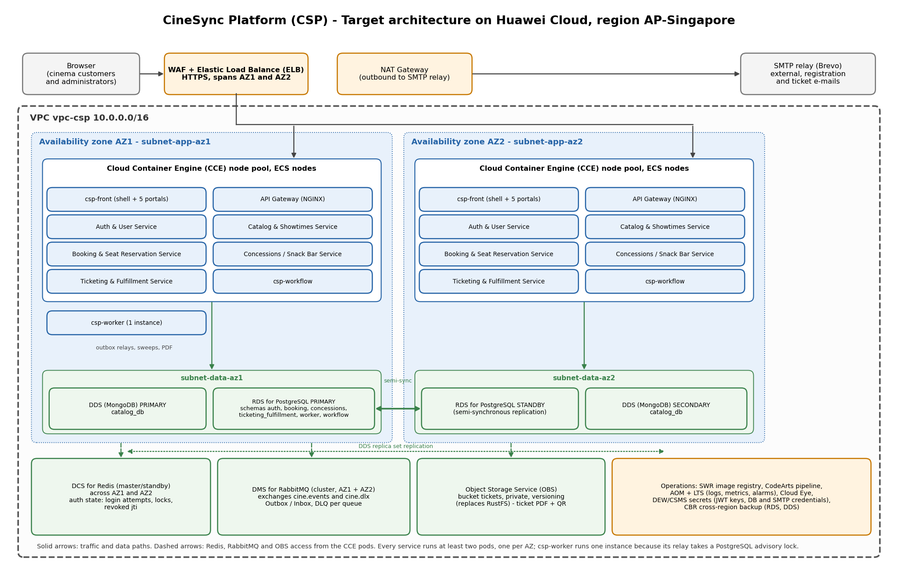

# Architecture design note -- CineSync Platform

## 1. Target architecture

CineSync Platform (CSP) sells cinema seats, concessions and tickets. Today it runs only on a developer machine with Docker Compose (`10-devops/environments.md`). This note moves the same system to Huawei Cloud, region AP-Singapore, inside one VPC with two availability zones, AZ1 and AZ2. Every service runs at least one pod per zone on a Cloud Container Engine (CCE) node pool behind a WAF and an Elastic Load Balance (ELB) that spans both zones.

The three Docker networks of `05-architecture/deployment.md` become three tiers of the VPC. Only the load balancer is public and it reaches the API Gateway; the services sit in application subnets, one per zone; and the databases, the broker, Redis and the bucket are reached only from those subnets through security groups, never from the internet. The only outbound traffic is the e-mail to the SMTP relay, which leaves through a NAT Gateway.

Each component of the diagram and the `-docs` file that defines it:

| Component in the diagram | Cloud component | Defined in |
|---|---|---|
| csp-front (shell and five portals) | CCE pods, compute | `09-microservices/services/09-csp-front/runbook.md` |
| API Gateway (NGINX) | CCE pods behind ELB, network | `09-microservices/services/01-api-gateway/README.md` |
| Auth & User Service | CCE pods, compute | `09-microservices/services/02-auth-service/README.md` |
| Catalog & Showtimes Service | CCE pods, compute | `09-microservices/services/03-catalog-service/README.md` |
| Booking & Seat Reservation Service | CCE pods, compute | `09-microservices/services/04-booking-service/README.md` |
| Concessions / Snack Bar Service | CCE pods, compute | `09-microservices/services/06-concessions-service/README.md` |
| Ticketing & Fulfillment Service | CCE pods, compute | `09-microservices/services/05-ticketing-fulfillment-service/README.md` |
| csp-workflow | CCE pods, compute | `09-microservices/services/08-csp-workflow/runbook.md` |
| csp-worker | one CCE pod, compute | `09-microservices/services/07-csp-worker/runbook.md` |
| PostgreSQL (schemas auth, booking, concessions, ticketing_fulfillment, worker, workflow) | RDS for PostgreSQL primary/standby, database | `05-architecture/deployment.md` |
| MongoDB `catalog_db` | DDS replica set, database | `05-architecture/decisions/records/ADR-003-polyglot-persistence-strategy.md` |
| Redis (auth state) | DCS for Redis master/standby, database | `05-architecture/decisions/records/ADR-028-redis-instance-for-the-auth-state.md` |
| RabbitMQ (`cine.events`, `cine.dlx`) | DMS for RabbitMQ, messaging | `05-architecture/decisions/records/ADR-036-rabbitmq-instance-for-the-domain-events.md` |
| RustFS bucket `tickets` | OBS bucket, storage | `05-architecture/decisions/records/ADR-058-object-storage-for-the-ticket-pdf-rustfs.md` |
| SMTP relay | external, reached through a NAT Gateway | `05-architecture/decisions/records/ADR-034-email-change-and-verification-code-delivery.md` |

## 2. Five principles

Each weakness below is something that the documentation itself states, not a generic risk. The decisions keep the stack that the team already chose (Go and Java services, PostgreSQL, MongoDB, RabbitMQ, Redis) and change only where and how it runs.

| Principle | Current weakness | Evidence in -docs | Design decision | Huawei Cloud service |
|---|---|---|---|---|
| Reliability | The ticket PDFs live on one RustFS node with one volume, without replication, and no restore test has ever been run. | `13-operations/backup-and-recovery.md` | Store the bucket `tickets` in a versioned OBS bucket and run PostgreSQL as primary and standby in two zones. | OBS, RDS for PostgreSQL |
| Security | The gateway only checks that the `Authorization` header exists, and the secrets are plain environment variables outside the local setup. | `05-architecture/overview.md` | Stop attacks at the edge, keep the JWT keys and credentials in a secret manager, and open each data store only to its own tier. | WAF, DEW (CSMS), VPC security groups |
| Performance efficiency | The target is a P95 under 300 ms at 200 concurrent requests per second, but read replicas are postponed and no load test has run. | `04-requirements/non-functional.md` | Autoscale the pods, add an RDS read replica for booking reads and run the k6 load test in qa before each release. | CCE autoscaling, RDS read replica |
| Cost | Every environment provisions the same instance set, so qa costs as much as production. | `05-architecture/deployment.md` | Run qa with small pay-per-use flavors and scale its node pool to zero outside working hours; buy production yearly. | CCE node pools, ECS pay-per-use flavors |
| Operations | No workflow deploys, GitHub Actions is locked by billing, and the deploy log says "pending first deploy". | `10-devops/ci-cd.md` | Build, scan and deploy through one pipeline that pushes images to a registry, rolls out with approvals and raises alarms. | CodeArts, SWR, AOM |

## 3. Scalability

The services are stateless, and seat locking is enforced in the database transaction, so adding pods never breaks the no-double-booking rule (`04-requirements/non-functional.md`, NFR-003). CCE autoscaling adds worker nodes when pods stay pending, between two and six nodes per zone.

| Service | Metric that triggers scaling | Threshold | Minimum pods | Maximum pods |
|---|---|---|---|---|
| Booking & Seat Reservation Service | CPU usage of the pods | above 65 % for 3 minutes | 2 | 8 |
| API Gateway | Requests per second per pod | above 150 requests/s | 2 | 6 |
| Ticketing & Fulfillment Service | Messages waiting in its RabbitMQ queues | above 500 messages | 2 | 6 |

Each policy waits five minutes after a scaling action before the next one, so a short peak cannot make the pod count oscillate. In the qa pipeline I check the thresholds with the k6 load test that `04-requirements/non-functional.md` already asks for: 200 concurrent seat holds against one showtime must keep the P95 under 300 ms while the pods grow, and a Ticketing backlog must drain without duplicate tickets because every consumer discards an `eventId` it has already stored.

`csp-worker` stays at one pod on purpose: each relay run takes a PostgreSQL advisory lock, so a second instance would do nothing (`09-microservices/services/07-csp-worker/runbook.md`).

## 4. Disaster recovery

The most critical data store is the PostgreSQL instance, because its `booking` schema protects the invariant that a seat is never sold twice. The documented targets for Booking are RTO 30 minutes and RPO 5 minutes (`13-operations/backup-and-recovery.md`), and I keep them: **RTO = 30 minutes, RPO = 5 minutes**.

The pattern from chapter 11 is a same-city dual-zone setup with remote disaster recovery: RDS primary in AZ1, standby in AZ2 with semi-synchronous replication, plus incremental log backups every 5 minutes copied to a second region by Cloud Backup and Recovery.

- If AZ1 fails, the standby already holds every committed transaction and RDS promotes it automatically within minutes, so no data is lost and the 30-minute RTO is met.
- If the whole region fails, the copied backups are at most 5 minutes old and a restore into a new instance has to finish inside 30 minutes; a daily backup alone could never meet a 5-minute RPO, which is why the log backups are required.

The other stores need less. MongoDB `catalog_db` keeps the documented daily snapshot, because administrators can rebuild the catalog and its RPO is 24 hours. Redis keeps no backup, because ADR-028 defines its state as disposable. The bucket `tickets` relies on versioning, and after a restore the worker republishes outbox rows while consumers discard duplicates by `eventId`.

The restore time is a design assumption until the quarterly restore test that the same document requires has been run.

## 5. Automated deployment

Only the pull request pipeline exists today (`ci.yml`). The deploy stages are the target design of `10-devops/ci-cd.md`, run by CodeArts Pipeline on CCE with images in SWR. Paths are `repository/path`.

| Stage | Trigger | Tool or service | File in your team's repositories |
|---|---|---|---|
| Build | Pull request to `develop` | CodeArts Build (Maven or Go build) | `csp-booking-api/.github/workflows/ci.yml` |
| Test | Every push of a pull request | Unit tests and Testcontainers | `csp-auth-api/.github/workflows/ci.yml` |
| Image | Merge to `develop` | CodeArts Build pushes the image to SWR | `csp-booking-api/deploy/Dockerfile` |
| Database migration | Before each API deploy | Flyway job of the `-db` repository | `csp-booking-db/.github/workflows/db-ci.yml` |
| Deploy to qa | Promotion `develop` to `qa` | CodeArts Deploy to the CCE namespace `csp-qa` | `csp-booking-api/deploy/compose.yml` |
| Deploy to production | Manual approval, promotion `qa` to `main` | CodeArts approval gate, rolling update on `csp-prod` | `csp-docs/10-devops/ci-cd.md` |
| Rollback | Failed `/health/ready` or manual decision | `kubectl rollout undo` on CCE | `csp-docs/09-microservices/services/04-booking-service/runbook.md` |

The migration stage runs before each deploy because redeploying an API never reverts its schema: the only way back is the `U` script of the `-db` repository, which needs the approval of the Tech Lead and is recorded as a recovery.

The gates come from `10-devops/ci-cd.md` and `05-architecture/deployment.md`: an image with a critical or high vulnerability blocks the deploy, a release to production needs the approval of the Tech Lead and the owner of the service, images are never deployed from a workstation, and the secrets reach the pods from the secret manager instead of the image.

## 6. Decisions

- [ADR-C3-01](ADR-C3-01.md): run PostgreSQL as RDS primary/standby in two zones with cross-region backup copies (sections 2 and 4).
- [ADR-C3-02](ADR-C3-02.md): deploy the services on CCE with autoscaling and a CodeArts pipeline with rolling updates (sections 3 and 5).
